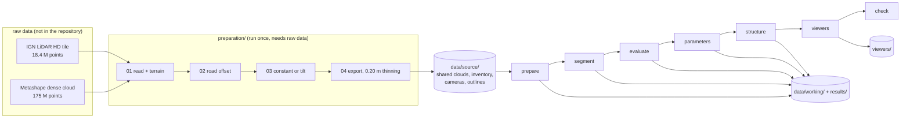

# Architecture

## Data flow



Everything after `data/source/` is reproduced by `python run.py all` in about
12 minutes on a laptop, from files that are in the repository.

## Stages

| stage | module | reads | writes |
|---|---|---|---|
| `prepare` | `hedgeseg/prepare.py` | `data/source/clouds/*.laz`, inventory, hedge outline | `data/working/clouds_full.npz`, `inventory.csv` |
| `segment` | `hedgeseg/segmentation/pipeline.py` | working clouds + inventory | `data/working/six_method_labels_full.npz`, `hybrid_labels.npz`, `baseline_labels.npz` |
| `evaluate` | `hedgeseg/evaluation/photographs.py` | labels, cameras, outlines | `results/tables/evaluation_*.csv`, `method_comparisons.csv` |
| `parameters` | `hedgeseg/structure/parameters.py` | labels, inventory | `results/parameters/parameters_all_methods.csv`, `vertical_profiles.csv` |
| `exclusions` | `hedgeseg/evaluation/exclusions.py` | inventory, outlines, parameters | `results/tables/tree_status.csv` |
| `conflict` | `hedgeseg/evaluation/conflict.py` | wider-window parents | `results/tables/conflict_*.csv` |
| `occupancy` | `hedgeseg/evaluation/carve3d.py` | labels, cameras, outlines | `results/tables/carve3d_*.csv`, `occupancy_*.csv` |
| `volumes` | `hedgeseg/structure/volumes.py` | labels, parameters | `results/tables/crown_volume*.csv` |
| `solids` | `hedgeseg/structure/solids.py` | labels, outlines | `results/tables/solids.csv` |
| `hedge-height` | `hedgeseg/structure/hedge_height.py` | working clouds | `results/tables/canopy_*.csv` |
| `review-queue` | `hedgeseg/structure/quality.py` | parameters, scores | `results/tables/structural_*.csv` |
| `viewers` | `hedgeseg/viewers/build.py` | everything above, display photos | `viewers/`, `results/point_clouds/ennezat_all_methods.laz` |
| `check` | `hedgeseg/checks.py` | everything | `results/qa/integration_checks.json` |
| `camera-replay`, `road-residuals` | `hedgeseg/cameras/` | calibration observations, shared clouds | `results/calibration/`, `results/qa/` |

Groups: `core` = prepare → parameters; `structure` = the seven structure stages;
`all` = everything except the camera diagnostics.

## Package layout

```
src/hedgeseg/
├── io.py                 paths (ROOT, data/source, data/working, results) and loaders
├── prepare.py
├── segmentation/
│   ├── constants.py      every numerical setting of the methods
│   ├── scoring.py        cost matrix → label + margin
│   ├── seeds.py          basal seeds, wider window
│   ├── stem_paths.py     shortest-path scores
│   ├── canopy_peaks.py   canopy-height model, peaks, upper seeds
│   ├── height.py         field-height penalty, classes, requests
│   ├── transfer.py       ALS → UAV
│   ├── combine.py        point-by-point merge
│   ├── baselines.py      nearest stem, watershed
│   ├── methods.py        the eleven recipes
│   └── pipeline.py       runs them, writes label files
├── evaluation/           photographs.py, context.py, review_io.py, exclusions.py, conflict.py, carve3d.py
├── structure/            parameters.py, volumes.py, solids.py, hedge_height.py, quality.py, summary.py
├── viewers/              build.py, review_tool.py, tree_tool.py, photos.py, templates/
├── cameras/              calibration_replay.py, registration.py
└── checks.py
```

## Design rules

* **Inputs are never modified.** `data/source/` is read-only; every stage writes to `data/working/` or `results/`.
* **One definition per quantity.** Evaluation is defined once (`evaluation/`), constants once (`segmentation/constants.py`, `config/project.json`).
* **Receipts.** Each stage writes a JSON receipt to `results/qa/` with input hashes and counts; `run.py` logs every stage to `results/qa/execution.jsonl`.
* **No silent offsets.** The shared clouds already share one vertical reference; `prepare` refuses any extra shift.

## Label file format

`six_method_labels_full.npz`: for each code in `G_none, G_lower_050, T_none, T_lower_100, T_coarse2_mid, T_targeted_1`
and each sensor `als`/`uav`: `<code>_<sensor>_label` (tree number per point, 0 = none),
`<code>_<sensor>_margin` (cost gap), `<code>_<sensor>_candidate` (same as label; kept for compatibility).
`hybrid_labels.npz`: `G_*`/`T_*` (wider-window parents), `hybrid_*_label`, `used_fallback`, `ids`.
`baseline_labels.npz`: `Nearest_stem_XY`, `Watershed`. UAV arrays follow the point order of `clouds_full.npz`.
